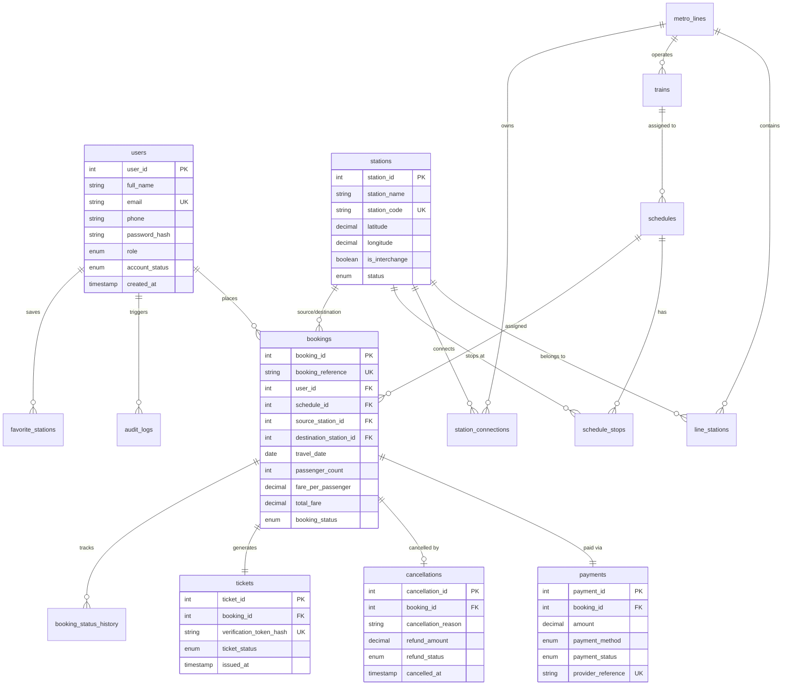

# MetroX 3D — Advanced Smart Metro Reservation and Management System

MetroX 3D is a full-stack, enterprise-grade, futuristic metro reservation and fleet management platform developed for modern metropolitan rapid transit networks. It features a Three.js 3D spatial simulation, a graph-based multimodal route planning engine (Dijkstra / BFS), authoritative server-side fare calculations, a payment simulation workflow, cryptographically verifiable electronic QR tickets, a cancellation refund engine, and an administrative control console backed by a normalized MySQL 8 relational schema with stored procedures, views, triggers, and transactions.

---

## 1. Key Features

- **Futuristic 3D Station & Train Visualizer**: Built with Three.js, rendering an aerodynamic train model, neon rail guides, soft volumetric mist, and mouse parallax camera movement. Includes automatic context-loss recovery and a graceful 2D fallback.
- **Interactive 3D Metro Network**: Spatial isometric map featuring 3 distinct metro lines (Blue Airport Express, Red Central Corridor, Green Tech Ring), glowing interchange hubs, real-time animated train markers, and route path highlighting.
- **Graph-Based Route Planning Engine**: Stations represented as graph nodes and connections as weighted edges. Compares routes by Minimum Travel Time (Dijkstra), Minimum Transfers, and Fewest Stops (BFS), with interchange transfer buffer calculation.
- **Server-Side Authoritative Fare Engine**: Supports stop-based and distance-based fare policies with mathematical rounding and historical policy versioning.
- **10-Step Ticket Booking & Payment Simulation**: Atomic booking creation with capacity verification, idempotency protection against duplicate submissions, and simulated multi-channel payment (UPI, Credit/Debit Card, Net Banking).
- **Electronic QR Boarding Passes**: Renders turnstile-ready boarding passes with dynamic HTML5 canvas QR codes containing opaque verification hashes. Supports print and PDF downloads.
- **Automated AFC Turnstile Scanner**: Real-time gate turnstile verification tool to test QR token validity against the database.
- **Passenger Account & Cancellation Policy**: Passenger dashboard with upcoming trip passes, historical records, and a tiered cancellation refund system (>60 min: 100%, 15–60 min: 50%, <15 min: 0%).
- **Administrative Telemetry & Control Center**: Role-secured dashboard with real-time financial metrics, daily revenue charts, passenger management, booking management, and a live MySQL database schema inspector.

---

## 2. Technology Stack

- **Frontend**: React 19, TypeScript, Three.js, Tailwind CSS 4, Lucide Icons
- **Backend**: Node.js, Express.js, REST API architecture, JWT authentication, bcrypt password hashing
- **Database**: MySQL 8.0+ / High-Performance Dual-Engine (live MySQL with automatic fallback to an in-memory relational store)
- **Algorithms**: Dijkstra's Shortest Path, Breadth-First Search (BFS)
- **Tooling**: Vite 8, tsx, npm

---

## 3. Entity-Relationship (ER) Diagram



---

## 4. Advanced MySQL 8 Features Demonstrated

### A. Stored Procedures (`database/procedures.sql`)
1. **`sp_calculate_fare`**: Calculates traversal stop count and distance between source and destination stations, applies active fare rule rates, and outputs unit fare and grand total.
2. **`sp_get_booking_details`**: Performs joins across bookings, users, stations, schedules, trains, payments, and tickets for a given booking reference.
3. **`sp_get_daily_revenue`**: Aggregates gross payments and refund deductions between two dates.

### B. Database Views (`database/views.sql`)
1. **`vw_booking_details`**: Flattens normalized relational tables for query efficiency.
2. **`vw_daily_revenue`**: Computes total transactions, gross revenue, refunds, and net revenue grouped by payment date.
3. **`vw_station_popularity`**: Ranks stations by combined origin departures and destination arrivals.

### C. Database Triggers (`database/triggers.sql`)
1. **`trg_after_booking_status_change`**: Automatically logs state transitions into `booking_status_history`.
2. **`trg_after_cancellation_audit`**: Logs cancellation events and refund amounts to `audit_logs`.
3. **`trg_after_payment_completed`**: Inserts an audit event when payments complete.

### D. Transactions & Concurrency Control (`database/reports.sql`)
Demonstrates atomic ACID transactions:
```sql
START TRANSACTION;
SELECT t.train_id, t.capacity FROM schedules s JOIN trains t ON s.train_id = t.train_id WHERE s.schedule_id = 1 FOR UPDATE;
INSERT INTO bookings (...) VALUES (...);
INSERT INTO payments (...) VALUES (...);
INSERT INTO tickets (...) VALUES (...);
COMMIT;
```

---

## 5. Development Credentials

Pre-seeded accounts for testing:

| Role | Email | Password | Access Level |
| :--- | :--- | :--- | :--- |
| **Administrator** | `admin@metrox.internal` | `Admin@123` | Full Admin Console, Metrics, DB Inspector |
| **Passenger** | `passenger@metrox.internal` | `Metro@123` | Route Planner, Booking, E-Tickets |

---

## 6. Project Folder Structure

```
├── database/
│   ├── schema.sql         # 16 Normalized MySQL 8 tables & constraints
│   ├── seed.sql           # Realistic lines, stations, trains, seed bookings
│   ├── procedures.sql     # sp_calculate_fare, sp_get_booking_details, etc.
│   ├── views.sql          # vw_booking_details, vw_daily_revenue, etc.
│   ├── triggers.sql       # Automated audit & status tracking triggers
│   └── reports.sql        # Advanced JOINs, aggregations, and transaction scripts
├── server/
│   ├── db/
│   │   └── connection.ts  # Dual MySQL / Relational engine manager
│   ├── middleware/
│   │   └── auth.ts        # JWT validation, rate limiting, role authorization
│   ├── routes/            # REST API endpoints
│   └── services/
│       └── routeService.ts# Graph-based Dijkstra and BFS pathfinding
├── src/
│   ├── components/
│   │   ├── 3d/
│   │   │   ├── HeroMetroScene.tsx # Three.js futuristic train & track
│   │   │   └── MetroNetwork3D.tsx # Three.js 3D isometric network map
│   │   ├── Navbar.tsx
│   │   ├── HeroSection.tsx
│   │   ├── RoutePlanner.tsx
│   │   ├── BookingModal.tsx
│   │   ├── TicketView.tsx
│   │   ├── TicketVerifier.tsx
│   │   ├── PassengerDashboard.tsx
│   │   ├── AdminDashboard.tsx
│   │   └── StationsDirectory.tsx
│   ├── App.tsx
│   ├── main.tsx
│   └── index.css
├── scripts/
│   └── create-admin.ts    # Admin provisioning CLI script
├── tests/
│   └── backend.test.ts    # 20-scenario automated verification suite
├── server.ts              # Express & Vite full-stack entry point
├── package.json
└── README.md
```

---

## 7. Running the Application

### Prerequisites
- Node.js 18+
- npm 9+
- MySQL 8.0+ (Optional: application includes an automatic embedded fallback if MySQL is not running)

### Setup & Launch
```bash
# 1. Install dependencies
npm install

# 2. (Optional) Run against local MySQL 8 database:
# mysql -u root -p < database/schema.sql
# mysql -u root -p < database/views.sql
# mysql -u root -p < database/procedures.sql
# mysql -u root -p < database/triggers.sql
# mysql -u root -p < database/seed.sql

# 3. Start development server (serves frontend & backend on port 3000)
npm run dev

# 4. Run automated test suite
npx tsx tests/backend.test.ts
```

---

## 8. College Mini-Project Presentation Guide

When presenting this project:
1. **Architecture Overview**: Highlight the 3-tier architecture: Three.js frontend, Express.js REST API with JWT security, and MySQL 8 relational schema with stored logic.
2. **3D Visuals Demo**: Demonstrate the 3D train model in the Hero section and the interactive 3D Metro Network page showing lines, stations, and animated trains.
3. **Graph Algorithm Demo**: Explain how Dijkstra's algorithm and BFS navigate the station network to find the fastest journey vs. fewest transfers.
4. **Booking & Transaction Integrity**: Walk through booking a ticket, observing server-side fare calculation, idempotency protection, and atomic ticket issuance.
5. **Turnstile Gate Verification**: Open the **QR Gate Verify** scanner, enter the generated token, and show how the server validates database status.
6. **Cancellation & Tiered Refunds**: Cancel a ticket to demonstrate the time-based refund calculation (>60 min = 100%, 15–60 min = 50%, <15 min = 0%) and the trigger that records the status change in `booking_status_history`.
7. **Admin Dashboard & SQL Inspection**: Log in as `admin@metrox.internal` to show live revenue charts and the Database Schema Inspector.
